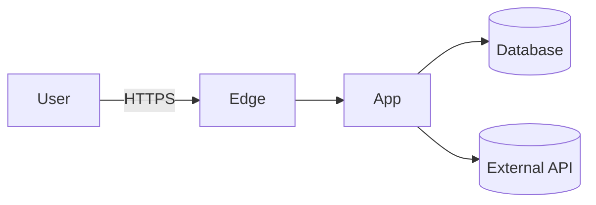

# Threat Model — <system / feature>

- **Date / version:**
- **Participants:**

## 1. Scope & assets
What are we protecting? (data classes, credentials, money, availability, reputation)

## 2. Architecture & trust boundaries
Data flow diagram (Mermaid) marking trust boundaries: internet ↔ edge, app ↔ DB, app ↔ third parties, tenant ↔ tenant, user ↔ admin.

## 3. Threat actors
External attacker, malicious user/tenant, compromised dependency, insider, compromised agent/LLM input.

## 4. Threats (STRIDE)
| # | Element | Category | Threat | Likelihood | Impact | Mitigation | Status |
|---|---|---|---|---|---|---|---|
| 1 | | Spoofing | | | | | |
| 2 | | Tampering | | | | | |
| 3 | | Repudiation | | | | | |
| 4 | | Info disclosure | | | | | |
| 5 | | Denial of service | | | | | |
| 6 | | Elevation of privilege | | | | | |

## 5. Accepted risks
Risk, rationale, owner, review date.

## 6. Follow-ups
